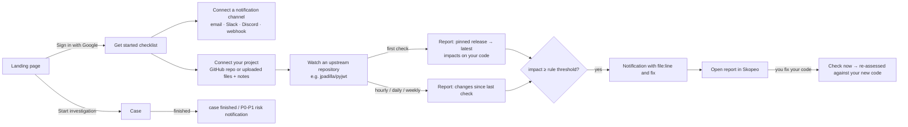

# User flow

Skopeo has two complementary uses:

1. **Investigate a repository** (anyone): multi-agent risk analysis of a GitHub repo, as before.
2. **Keep watch over your own software** (signed in): connect your project, watch the
   open-source repositories it depends on, and get told, with file and line, how their changes
   affect your code.

## 1. Sign in

* **Sign in with Google** (top right, or the banner on the landing page). Setup:
  [firebase-setup.md](firebase-setup.md).
* Without Firebase configured, the server runs in *local mode*: there is no sign-in and one
  local workspace owns everything.
* **Account** (avatar menu): profile, sign out, and **Delete my account**, which removes
  projects, files, watches, reports, channels, rules and the delivery log.

## 2. Connect notification channels

**Settings → Notifications**, documented in [notifications.md](notifications.md).

1. Pick **Email / Slack / Discord / Webhook**, paste the address or URL, tick the events.
2. Email addresses other than your Google address get a 6-digit code, which you enter on the
   channel.
3. **Send test** checks the channel end to end. **Pause** stops it without deleting it.
4. **Rules** refine each event: which channels, minimum priority / impact, one project or one
   watched repository only.
5. The **delivery log** shows every attempt: sent, failed (with the error), skipped (e.g.
   "channel not verified") or dry run.

## 3. Connect your project (the context)

**Projects → New project**:

* **Upload files** for private code. Choose files or a whole folder. Only `.py`, `.js`, `.ts` (and
  variants) plus dependency manifests (`requirements*.txt`, `pyproject.toml`, `setup.cfg`,
  `Pipfile`, `package.json`) are kept, and that filtering happens in the browser. Limits:
  400 files, 400 KB each, 3 MB per project. You can add, update or remove files later.
* **Public GitHub repository**: Skopeo makes a fresh shallow clone on every check, so your newest
  code is always what's analysed.
* **Notes** (optional): how you use your dependencies ("PyJWT verifies session tokens in
  `auth/`"). They are included as context in the report and, in live mode, in the LLM summary
  (as untrusted data).

Code is **parsed, never executed**.

## 4. Watch an upstream repository

On the project page, **Watch an open-source dependency**: paste its GitHub URL and pick a
frequency (hourly, daily, weekly, or only when you click **Check now**). Advanced options let
you set a branch, the package name (e.g. `PyJWT`) and import names (e.g. `jwt`). By default
Skopeo detects them from the upstream repository.

### What a check does

1. Shallow-clones the upstream and extracts its **public API surface**:
   * functions, classes and methods with parameters (kind, default);
   * re-exports (`from .api_jwt import decode`) and bound methods (`decode = _obj.decode`);
   * deprecation markers;
   * a hash of each body;
   * **contracts hidden in the body**: a parameter that triggers a `DeprecationWarning`, or one
     whose absence raises (`if not algorithms: raise DecodeError(...)`), followed through helper
     calls (`self._jws.decode_complete(...)`, other modules).
2. Picks the **baseline**:
   * first check: the release tag matching the version your manifest pins (e.g. `PyJWT==1.7.1` →
     tag `1.7.1`), so you immediately see what upgrading means;
   * later checks: the snapshot stored by the previous check;
   * **Compare with my pinned version**: pinned release vs latest again.
3. **Diffs** the two surfaces into changes. Each change is one of:
   * `removed`, `moved` or `module_removed`;
   * `signature`: removed, newly required, keyword-only or reordered parameters, or changed
     defaults;
   * `contract` or `deprecated`;
   * `behavior`: same signature, new implementation;
   * `added`.

   It also extracts changelog entries mentioning breaking changes, removals, deprecations,
   defaults or security advisories.
4. Finds where **your project** uses the library: imports, aliases, calls (with positional
   count and keyword names) and attribute references. JS/TS uses import and require analysis.
5. Joins the two and checks each call against the new signature. The result is an **impact
   list** with level (`breaking`, `high`, `medium`, `low`), certainty, the line of code, an
   explanation, the old and new signatures, and a concrete fix.
6. Stores a report, schedules the next check, and sends `watch.impact` / `watch.update` /
   `watch.failed` notifications according to your rules.

When nothing changed upstream, a scheduled check records nothing new. **Check now** re-assesses
the last report's changes against your *current* code, so after you fix a call you can confirm
it's resolved.

### Example (a real run against `jpadilla/pyjwt`)

Project files: `requirements.txt` pins `PyJWT==1.7.1`, and `app/auth.py` calls
`jwt.decode(token, SECRET, verify=False)`.

| Level | Where | What Skopeo says |
| --- | --- | --- |
| breaking | `app/auth.py:9` | This call does not pass `algorithms`; upstream now raises when it is missing: "It is required that you pass in a value for the "algorithms" argument when calling decode()." Fix: pass `algorithms=` explicitly. |
| medium | `app/auth.py:15` | `jwt.encode` relies on the default of `algorithm`, which changed from `'HS256'` to `_ALGORITHM_UNSET`; check the new default behaves the same. |
| low | `app/auth.py:19` | `jwt.decode(..., algorithms=["HS256"])`: signature changed, your call still fits. |

Summary: *"jpadilla/pyjwt changed 49 public API element(s) (29 breaking) and added 50 between
1.7.1 → master. 3 place(s) in shopfront-api are affected across 1 file(s), 1 of them breaking."*

## 5. Investigations and notifications

When you are signed in, cases you start are recorded as yours (`GET /api/investigations?mine=true`).
When one finishes you receive `investigation.completed`; if it has a verified risk at or above
your threshold (P1 by default) you also receive `investigation.risk`, with the top risks listed.

## Limits

* Upstream analysis is deepest for Python (AST). JS/TS uses export and import patterns:
  signatures and removals, but no body contracts.
* Behaviour that depends on runtime values beyond the rules above is not detected. The
  changelog highlights and the `behavior` changes point you at what to review.
* Watch checks run inside the API process. On hosts that sleep or scale to zero (Render free
  plan, Cloud Run), scheduled checks only run while the service is awake. Use an always-on
  instance, or keep it awake with an uptime monitor that requests `/api/health` every few minutes.
